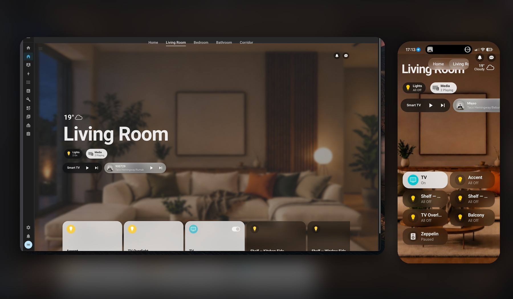
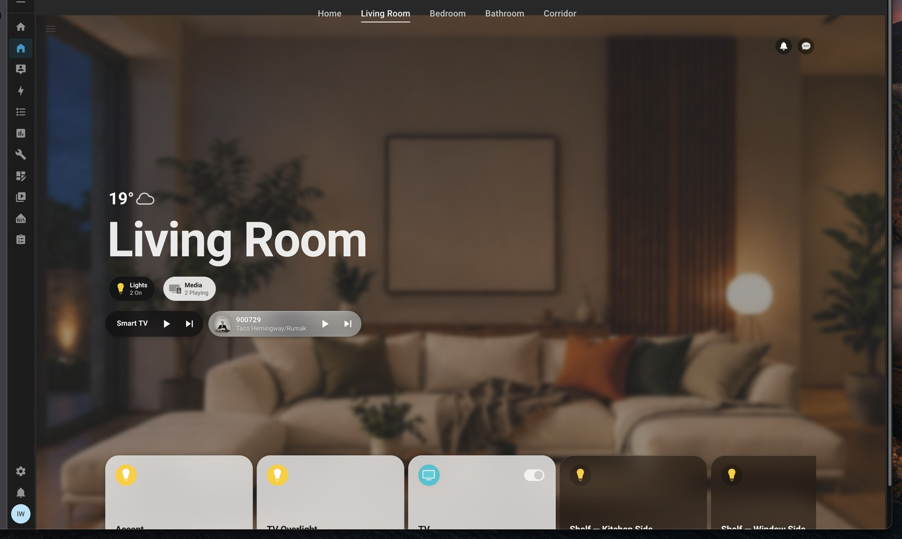
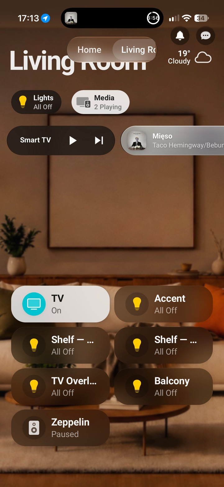
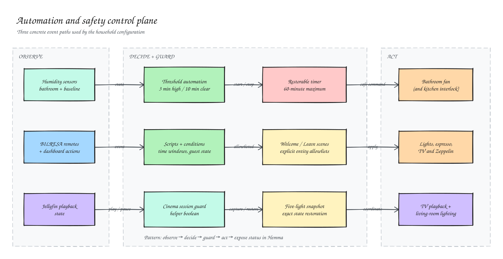

# Home Assistant Hemma Setup

[](https://www.home-assistant.io/)
[](https://github.com/willsanderson/Hemma)
[](LICENSE)

My responsive Home Assistant setup built on [Hemma](https://github.com/willsanderson/Hemma), with an Apple Home-inspired room layout, an embedded Music Assistant view, physical TV controls, Jellyfin Now Playing, custom lighting tiles, energy monitoring, and phone/desktop layouts from one YAML dashboard.



## Highlights

- Six room views plus a dedicated Music Assistant view with shared navigation
- Responsive desktop, tablet, and phone layouts
- Jellyfin playback metadata, artwork, progress, and transport controls
- Separate physical TV power controls and Android TV app launchers
- Compact living-room entertainment hub opened from the TV tile, with current Jellyfin title/artwork, an Apple-like D-pad, Home, back, play/pause, a contextual launcher that appears only while the TV is on and promotes the active app, a Jellyfin **Resume** action while paused, a one-tap Cinema routine, and a left-side 0–60% volume slider with native +1%/−1% and mute controls. Jellyfin, YouTube, and Spotify use verified installed BRAVIA app IDs.
- Custom HomeKit TV wrapper with iPhone Remote key forwarding
- Smart light-group toggles that restore the previous member state
- Energy monitoring with a monotonic utility meter and a Home header chip that shows the current power draw in watts
- Persistent wake-up alarm chips on Home and Bedroom, with schedule controls and a dedicated stop action
- A **Welcome Home** scene that restores the captured on-lights and keeps all other lighting off
- A live **What's still on?** Home chip with per-device shutdown controls and one-tap **All Off**
- Two-hour Lelit espresso-machine safety shutoff with a restart-restorable timer
- Jellyfin cinema mode with living-room light state restoration
- Bathroom humidity-driven ventilation using the bathroom sensor against the bedroom humidity baseline, with a restorable 60-minute maximum-runtime timer
- Bathroom forgotten-on protection for both bathroom lights
- IKEA BILRESA bedside remote with progressive night lighting and whole-home bedtime shutdown
- Corridor BILRESA dual-button mapping: Button 1 runs **Welcome Home** and Button 2 runs the universal **Leave Home** routine
- Bathroom Lamp control with a filament-style bulb icon
- Bedroom Bed Lamp tile with a dedicated bedside-lamp icon
- Bedroom Closet light tile with an outlined shirt icon
- Bedroom climate chip showing live indoor temperature and humidity from the IKEA TIMMERFLOTTE sensor; tapping a reading opens the combined current values and six-hour history
- Home-view air-quality chip showing outdoor European AQI, PM2.5, and PM10 estimates from Open-Meteo without an API key
- Home-view presence chip driven by a local Wi-Fi scan of the phone's fixed per-network private MAC, so presence follows connection to this building's network instead of the wider GPS home zone
- Restorable **Guest Mode** Home chip that suppresses automatic whole-home shutdown while visitors remain in the apartment
- Living Room Balcony light tile with a dedicated balcony-and-railing icon
- Living Room Zeppelin Light tile, included in the room lighting summary
- Kitchen extractor-fan tile with a dedicated range-hood icon
- Kitchen 1 light tile with a dedicated lightbulb-spot icon
- Kitchen LED light tile using the standard LED-strip icon
- Embedded Music Assistant web interface that stays inside Hemma and kiosk mode,
  opens the last-used player, and reserves safe navigation space on tablet and phone
- Apple-first typography using the native San Francisco system font where available
- Custom SVG icon set and room artwork

## Dashboard conventions

- Accessory interactions follow one rule throughout the dashboard: tap performs
  the primary action, long press opens detailed or native controls, and double
  tap is disabled unless a card has a deliberate secondary action. Lights,
  switches, and fans toggle on tap. The Living Room TV opens its remote on tap
  and native device information on long press.
  Light tiles call `homeassistant.toggle` directly against the card entity;
  their icon control keeps Hemma's snapshot-aware smart toggle.
- Header chips use a restrained, neutral pill; the circular icon carries the
  category or state color. This keeps the row visually quiet while making each
  chip's purpose predictable.
- Chip icon colors are assigned by type:
  - **Orange:** actions and scenes, including **Welcome Home**.
  - **Neutral:** informational status, including **Energy**.
  - **Green:** healthy, home, or active status, including **Presence** when
    someone is home.
  - **Blue:** scheduled automation, including an enabled or upcoming **Alarm**.
  - **Red:** attention required, such as a fault, warning, low battery, or an
    alarm that needs intervention.
- Scene and whole-home status controls use compact Hemma header chips rather than large action tiles. New
  scenes should follow the `hemma_badge_scene` template, use a circular orange
  HomeKit-style icon, and expose an active-state sensor when one is available.
- Cinema Mode is also presented as a compact action chip with an orange circular
  popcorn icon.

## Screenshots

### Desktop



### Phone

<p align="center">
  
</p>

## Automation and safety control plane

The editable Excalidraw source and generated SVG preview live in
[`docs/diagrams/`](docs/diagrams/README.md).

[](docs/diagrams/automation-control-plane.excalidraw)

## Repository layout

```text
config/
├── automations.yaml             # Household automations and physical remote mappings
├── scenes.yaml                  # Welcome Home lighting snapshot
├── custom_components/hemma/   # Hemma integration snapshot with local tweaks
├── dashboards/
│   ├── hemma/hemma.yaml       # Room and entity configuration
│   └── templates/             # Cards, badges, popups and responsive layouts
├── packages/
│   ├── hemma_helpers.yaml         # Helpers, scripts and dashboard automations
│   ├── guest_mode.yaml            # Guest override and network-presence automations
│   ├── homekit_tv.yaml            # TV wrapper and remote-key forwarding
│   ├── kitchen_fan.yaml           # Two-speed Tuya fan wrapper and relay interlock
│   ├── phone_network_presence.yaml # Local Wi-Fi presence sensor
│   └── bathroom_fan_humidity.yaml # Humidity control and restorable fan timer
├── shell/network_presence.sh      # MAC-targeted LAN scan used by the presence sensor
├── themes/hemma/              # Hemma theme and typography
└── www/hemma/                 # Icons and room images
```

## Automations

The source-controlled automation set is split between
[`config/automations.yaml`](config/automations.yaml) and the package files under
[`config/packages/`](config/packages/). The active behavior includes:
- **Bathroom Fan - Humidity control** — compares the bathroom humidity entity
  `sensor.timmerflotte_temp_hmd_sensor_humidity_2` with the bedroom reference
  `sensor.timmerflotte_temp_hmd_sensor_humidity`. It starts
  `fan.bathroom_fan_bathroom` when bathroom humidity stays for three minutes at
  or above `max(65%, bedroom humidity + 7 percentage points)`. It stops the fan
  after bathroom humidity remains within three percentage points of the bedroom
  reference for ten minutes. Both sensors must report valid values, so an
  unavailable reference cannot accidentally start or stop the fan.
- **Bathroom Fan runtime safety branch** — the humidity package uses the
  `timer.bathroom_fan_humidity_max_runtime` helper with `restore: true`. Manual
  or automatic fan activation starts a one-hour safety timer; stopping the fan
  cancels it, and timer expiry turns the fan off. The startup path re-establishes
  the one-hour protection if Home Assistant restarts while the fan is running.
- **Kitchen Extractor Fan - Relay interlock** — keeps the two relays behind the
  two-speed kitchen extractor mutually exclusive, including when a raw Tuya
  channel is operated directly.
- **Kitchen Extractor Fan - 60-minute timeout** — turns off the kitchen extractor
  after 60 minutes at either speed. Turning it off and back on starts a fresh
  timeout.
- **Wake up with music - Zeppelin** — switches on the Lelit espresso machine,
  then plays the shuffled Spotify playlist *Happy Jazz ☕ Relaxing Instrumental
  Bossa Nova Piano to Positive Mood* at the configured wake-up time when the
  wake-up helper is enabled. The playlist ID is `6j2DUZglv11u2UgCdozFXM`.
- **Stop wake-up music** — stops only the Zeppelin from the dashboard stop
  button; the espresso machine remains on.
- **Lelit Espresso Machine - Two-hour safety shutoff** — starts a restorable
  two-hour timer whenever the espresso-machine plug turns on, cancels it when
  the plug turns off, and switches the machine off when the timer expires. If
  Home Assistant restarts while the machine is on without an active restored
  timer, it starts a fresh two-hour safety window.
- **Living Room - Jellyfin cinema mode** — snapshots all five physical living-room
  circuits: Living Room Accent, TV Overlight, both shelf-light circuits, and the
  Balcony light. It turns them off when playback starts, restores their exact
  pre-cinema states when playback is paused or stopped, and avoids overwriting
  that snapshot during a pause/resume cycle by using
  `input_boolean.jellyfin_cinema_active` as the session guard. The Living Room
  **Cinema Mode** chip toggles the behavior; turning it off during playback
  restores the captured lights immediately. The TV popup’s **Cinema** button
  enables that mode, launches the verified Wholphin/Jellyfin app, and prepares
  the same guarded snapshot workflow. If playback is already active it dims
  immediately; otherwise the existing playback automation snapshots and turns
  off those five circuits when viewing starts.
- **Bathroom - Forgotten lights protection** — independently switches off the
  Bathroom LED Strip or Bathroom Lamp after either has remained on for 45
  minutes.
- **Bedroom Closet - Door light** — turns `light.bedroom_closet` on when `binary_sensor.myggbett_door_window_sensor_door` opens and off when it closes.
- **Bedroom - BILRESA bedside remote** — maps the IKEA `09B9` ZHA remote:
  - Single ON from 06:00 through 22:59 keeps the daytime behavior: Bed Lamp and
    LED Bed first, then Bedroom Accent.
  - Single ON from 23:00 through 05:59 turns on the Bathroom LED and then
    progressively enables LED Bed, Bed Lamp, and Bedroom Accent.
  - Single OFF turns off all three bedroom lights and the Bathroom LED.
  - Double ON turns on all three bedroom lights.
  - Double OFF activates `script.leave_home`. The centralized routine applies the
    19-target Leave Home scene, then conditionally turns off the one TV entity also
    used by Hemma: `media_player.living_room_tv_2`. Across the routine, 20 enabled,
    visible household entities are managed: sixteen lights, the Lelit espresso
    machine, kitchen extractor fan, Zeppelin, and the living-room TV. The bathroom
    fan stays outside the routine so its humidity schedule remains authoritative.
    Hidden, disabled, diagnostic, unavailable, duplicate-TV, and infrastructure
    entities are intentionally excluded.
  - While the configured wake-up alarm is playing, any mapped button press
    stops only the alarm without changing lights, running the bedtime shutdown,
    or switching off the espresso machine.
- **Corridor - Welcome Home / Leave Home** — maps the Matter BILRESA dual button:
  Button 1's single press runs `scene.welcome_home`, Button 1's double press starts
  the French Jazz Lounge playlist on the Zeppelin, and Button 2's single press runs
  `script.leave_home`.
- **Living Room - TRADFRI media remote** — maps the ZHA five-button remote to the
  active entertainment endpoint. Brightness up/down changes volume on the Zeppelin
  while it is playing, otherwise on the powered TV. A short center press toggles
  play/pause on the active Zeppelin or TV session, including resuming a paused
  session (falling back to the TV play/pause key); a long
  center press turns off both `media_player.zeppelin` and
  `media_player.living_room_tv_2`. Left/right skips tracks while Zeppelin music is
  playing and otherwise sends `DPAD_LEFT`/`DPAD_RIGHT` to
  `remote.living_room_tv`. Short and long presses on either brightness button each
  produce one volume step.
- **Ignacy Wi-Fi presence** — scans the local `/24` every 15 seconds with ARP-aware
  Nmap discovery and reports `home` only when the phone's fixed private Wi-Fi MAC
  is present. The MAC is read from `/config/private/ignacy_phone_wifi_mac`, which
  is intentionally excluded from this repository. Hemma's Home presence chip uses
  `sensor.ignacy_wi_fi_presence`; the Companion app battery remains attached to
  the chip.
- **Presence - Leave home when Ignacy disconnects** — reacts immediately when
  the Wi-Fi presence sensor changes to `not_home`, checks that
  `input_boolean.guest_mode` is off, then starts the same centralized
  `script.leave_home` routine used by the bedside and corridor buttons. Guest
  Mode restores its previous state after a restart and is controlled from a
  compact Home header chip.
- **Presence - Welcome Home before sunset** — twenty minutes before sunset,
  activates `scene.welcome_home` when Ignacy's phone is connected to the home
  Wi-Fi. Guest Mode does not suppress this lighting scene.
- **Presence - Welcome Home when Ignacy returns** — when the Wi-Fi presence
  sensor reconnects before 23:00, activates `scene.welcome_home` immediately.
  There is no arrival debounce or minimum-away requirement.

### Corridor French Jazz Lounge

Button 1's double press calls `script.french_jazz_lounge`, which uses Music Assistant
to replace the Zeppelin queue with Spotify playlist
`Jazzy Restaurant Music | Luxury Hotel Lounge Music` by Chill Ghost. It preserves the
sets the Zeppelin to 30% volume, and enables shuffle after the queue loads; the
playlist ID is `75tpCkAq8iJogkzHn7q6AW`.

## Welcome Home scene

[`config/scenes.yaml`](config/scenes.yaml) defines **Welcome Home** as a complete
physical-lighting snapshot. It turns on five cozy lights and explicitly keeps the
remaining responsive lighting entities off. **Zeppelin Light** is intentionally not
part of Welcome Home; it is still available as a separate Living Room light control.
Kitchen 1, Kitchen 2, Kitchen 3, and Kitchen LED are included with
`state: "off"` so the overhead and cabinet lighting stay dark. The Bathroom Lamp
switch also remains off. The
unavailable Bathroom Sonoff LED is temporarily excluded from this scene and its
active-state sensor, so it cannot block activation or the Hemma status
indication. Derived light groups and disabled infrastructure entities are
excluded to avoid duplicate or conflicting commands.

The Home view exposes the scene as a **Welcome Home** action tile. It is kept
first in the configured Home rail so Hemma's active-card sorting cannot push the
stateless scene beyond the initially visible controls. A template binary sensor,
`binary_sensor.welcome_home_scene_active`, compares the 15 currently included
physical lighting controls with the scene and drives both the tile highlight and
its **Active** or **Inactive** label. Unknown or unavailable included accessories
do not count as matching; the unavailable Bathroom Sonoff LED is not currently
included.
Activating the tile calls `scene.turn_on` for `scene.welcome_home`.

### Updating the captured lighting state

1. Set every physical light to the state you want after arriving home.
2. Inventory the enabled, non-hidden lighting entities in Home Assistant. Include
   each physical `light.*` entity and any `switch.*` entity that directly controls
   a lamp, such as `switch.bathroom_lamp`. Exclude derived light groups, disabled
   gateways, diagnostics, and infrastructure controls.
3. Update the `entities` map in the live `/config/scenes.yaml` and the matching
   [`config/scenes.yaml`](config/scenes.yaml) file in this repository. Update the
   `binary_sensor.welcome_home_scene_active` template in the live and repository
   copies of `config/packages/hemma_helpers.yaml` with the same entity/state set:
   - Set the desired active lights to `state: "on"`.
   - Preserve supported appearance attributes such as `brightness`,
     `color_temp_kelvin`, or `rgb_color` when the light exposes them and the
     appearance is part of the scene.
   - Keep every remaining physical lighting control in the scene with
     `state: "off"`; do not simply remove lights that should stay dark.
4. Back up the live file, upload the replacement under a temporary filename, and
   move it into place only after the backup exists.
5. Run `ha core check`, then reload **Scenes** from Home Assistant Developer Tools
   or restart Home Assistant. Confirm that `scene.welcome_home` is available.
6. Check that the Hemma Home view still contains exactly one `scene.welcome_home`
   tile. Activate the scene only when changing household lighting is acceptable.
7. Run `git diff --check` and `gitleaks`, update this documentation if the entity
   set changed, then commit and push only the intended files to `main`.

## Leave Home scene

[`config/scenes.yaml`](config/scenes.yaml) defines **Leave Home** from the exact
allowlist previously embedded in the bedside remote's double-OFF branch. Every
included entity is enabled, visible, and non-diagnostic in the live entity
registry. The scene sets sixteen responsive physical lights, the Lelit
espresso-machine switch, and the kitchen extractor fan to `off`. The Zeppelin
music is handled separately by `script.leave_home`, which sends
`media_player.media_pause` to the Music Assistant player entity
`media_player.zeppelin`. That player is backed by the Zeppelin DLNA player.
The hidden native DLNA entity `media_player.living_room` is not targeted because
its live feature set does not advertise pause support.
The physical living-room TV is handled separately by `script.leave_home`, using only
`media_player.living_room_tv_2`—the same entity displayed by Hemma. The script
continues when a media endpoint is already idle or rejects a redundant pause, and
skips the TV command when that entity is already `off`, `unknown`, or
`unavailable`, avoiding the Sony integration error caused by asking an already-off
BRAVIA to turn off again. Other entities representing the same physical TV are
not shutdown targets.

Leave Home does not include the bathroom fan, allowing its humidity-removal
schedule to keep running independently. It also does not include the Bathroom
Lamp because that entity was not part of the established bedside shutdown
allowlist. The unavailable Bathroom Sonoff LED is temporarily excluded from both
Leave Home and its active-state sensor, so it cannot block execution or status
feedback. Hidden, disabled, diagnostic, and infrastructure entities remain
excluded.

The bedside double-OFF branch, the corridor Button 2, and the Home chip's
**All Off** action all call `script.leave_home`. The script applies
`scene.leave_home`, pauses both Zeppelin control paths, then turns off the selected
Hemma TV only when needed. The chip summarizes the same physical-device allowlist,
opens a compact sheet containing only active devices, and gives each device its own
turn-off control. It replaces the old one-way **Leave Home** chip and the temporary
active-device cards on the Home view.

When changing the Leave Home allowlist, update these places together:

1. The non-TV targets in `scene.leave_home` in `config/scenes.yaml`.
2. The conditional Zeppelin pause targets and TV target in `script.leave_home` in
   `config/scripts.yaml`.
3. `binary_sensor.leave_home_scene_active` in
   `config/packages/hemma_helpers.yaml`.
4. The Home view's active-device allowlist in
   `config/dashboards/hemma/hemma.yaml`.
5. The Hemma TV card if the selected TV entity changes.
6. The allowlist description in this README.
7. The live files under `/config`, followed by `ha core check` and a Core restart
   or the appropriate scene/script/template/automation reloads.

Before adding any entity, confirm in `core.entity_registry` that `disabled_by`,
`hidden_by`, and `entity_category` are null. Never add broad domains, areas,
groups containing unreviewed members, servers, infrastructure switches, or
maintenance controls. Validate the scene and automation statically; activate the
scene only when a whole-home shutdown is safe.

## Kitchen dashboard

The Kitchen view is included in the shared room navigation on desktop, tablet,
and phone. **Kitchen 1**, **Kitchen 2**, and **Kitchen 3** are combined into one
dashboard-only **Spots** tile without creating another Home Assistant entity.
Tapping Spots turns all three off when any spot is on, or turns all three on when
they are all off. Holding it opens Hemma's light popup with separate controls for
each spot. **Kitchen LED** remains a separate tile with Hemma's standard
LED-strip icon. The view also contains a dedicated **Lelit Espresso Machine**
switch tile using an espresso-maker silhouette. The tile controls the IKEA
GRILLPLATS plug and reports its current on/off state.

The **Extractor Fan** tile now controls `fan.kitchen_extractor_fan`, a two-speed
template fan backed by the two relays of **2CH Wi-Fi Switch Module 4**. Speed 1
uses the first relay at 50%, Speed 2 uses the second relay at 100%, and changing
speed switches both relays off for 500 ms before energizing the selected relay.
A relay interlock also turns the opposite channel off if either raw Tuya switch
is operated directly. The two underlying `switch.*` entities are hidden in Home
Assistant's entity registry so the fan is the only user-facing control.

## Potential improvements

The remaining sensor expansion under consideration is:

- One motion sensor in the Bathroom for occupancy-aware lighting.
- One motion sensor in the Corridor for nighttime pathway lighting.

The bathroom temperature/humidity sensor and ventilation automation are now
implemented in [`config/packages/bathroom_fan_humidity.yaml`](config/packages/bathroom_fan_humidity.yaml).
The bedroom TIMMERFLOTTE sensor is the reference baseline; the bathroom sensor
must remain assigned to the Bathroom area and the bedroom sensor to Bedroom.

Potential follow-up automations:

- **Occupancy-aware bathroom lighting** — turn on the appropriate bathroom light
  when motion is detected and turn it off after 8–10 minutes without motion.
  The existing 45-minute forgotten-on automation should remain as a hard
  fallback because a PIR sensor may not detect someone standing still or behind
  a shower screen.
- **Corridor night pathway** — between approximately 23:00 and sunrise, use
  corridor motion to turn on only a low-impact pathway light, then turn it off
  after 2–3 minutes without motion.
- **Bathroom ventilation warning** — notify when high humidity persists despite
  the fan running or when the bathroom environmental sensor becomes unavailable.
- **Bedroom comfort monitoring** — expose temperature and humidity on the
  dashboard and notify only when uncomfortable conditions persist, avoiding
  noisy alerts for short-lived changes.
- **Motion-aware cinema behavior** — preserve Jellyfin cinema lighting while
  allowing brief corridor and bathroom pathway lighting when someone gets up.
- **Sensor health monitoring** — report low batteries and prolonged unavailable
  states for the environmental sensors, motion sensors, BILRESA remote, and
  other important Zigbee devices.
- **Presence-aware away shutdown** — turn off visible household devices after
  everyone leaves, with a Guest Mode helper to suppress the shutdown when
  someone remains home.

## Configuration change workflow

For every Home Assistant automation or other YAML change:

1. Back up the live file and edit a fresh copy from `/config`.
2. Update the matching file in this repository and document changed behavior
   in this README.
3. Deploy the reviewed YAML and run `ha core check`.
4. Reload the affected domain or restart Home Assistant, then verify the live
   entity or automation.
5. Scan the repository for secrets, commit only the intended files, and push to
   `IgnacyWie/home-assistant-hemma` on `main`.

## Requirements

- Home Assistant **2026.9.0 or newer**
- [HACS](https://hacs.xyz/)
- [UIX](https://github.com/Lint-Free-Technology/uix) — required
- [button-card](https://github.com/custom-cards/button-card) — required
- [apexcharts-card](https://github.com/RomRider/apexcharts-card) — used by chart popups
- [Kiosk Mode](https://github.com/NemesisRE/kiosk-mode) — used by the YAML dashboard
- The Date & Time integration with a time sensor, if you want the room clock

> [!IMPORTANT]
> This is a real configuration snapshot, not a drop-in generic dashboard. Replace every example entity ID in `config/dashboards/hemma/hemma.yaml` and the package files with entities from your own Home Assistant instance before enabling it.

## Installation

### 1. Back up Home Assistant

Create a Home Assistant backup before copying any files.

### 2. Install frontend dependencies

Install UIX, button-card, apexcharts-card, and Kiosk Mode through HACS. Do not install `card-mod` alongside UIX unless you have separately verified that combination.

### 3. Copy the configuration

Copy the contents of this repository's `config/` directory into `/config/` on Home Assistant. Review changes first if those folders already exist.

The vendored `custom_components/hemma/` directory reproduces the dashboard shown here. If you prefer to track upstream Hemma through HACS, install [willsanderson/Hemma](https://github.com/willsanderson/Hemma) instead and port only the dashboard/theme overrides you need.

### 4. Enable packages, themes, and the YAML dashboard

Merge the relevant sections from [`configuration.example.yaml`](configuration.example.yaml) into your own `/config/configuration.yaml`.

### 5. Replace entity IDs

At minimum, review:

- `config/dashboards/hemma/hemma.yaml`
- `config/packages/homekit_tv.yaml`
- the energy entities in `config/packages/hemma_helpers.yaml`
- room images and view names
- Android TV package/activity IDs used by the Jellyfin and YouTube launch buttons

The published dashboard uses `person.example_user` as a privacy-safe placeholder.

### 6. Validate and restart

```bash
ha core check
ha core restart
```

After Home Assistant returns, select the **Hemma** theme from your profile and open the **Home** dashboard.

## TV architecture

The setup intentionally separates two responsibilities:

- `media_player.living_room_tv_2` controls physical television power and app launching.
- `media_player.tv_w_salonie` is the responsive Jellyfin playback entity used by the cinema automation and Hemma Now Playing state for title, progress, episode metadata, and transport state.

The HomeKit wrapper exposes a stable TV source list and forwards Apple's standard remote keys to the Android TV remote entity.

## Security and privacy

No `.storage` files, databases, authentication data, tokens, internal URLs, or `secrets.yaml` are included. Personal presence entities were replaced with examples, and the one-time energy-meter calibration from the live system was intentionally removed.

Run your own secret scanner before publishing changes. Never commit Home Assistant backups, databases, `.storage`, `secrets.yaml`, access tokens, webhook IDs, or private certificates.

## Upstream and attribution

This repository is a personalized configuration built on [Hemma](https://github.com/willsanderson/Hemma) by [Will Sanderson](https://github.com/willsanderson), which is licensed under the MIT License. Hemma itself credits [Homio](https://github.com/iamtherufus/Homio) as the original concept and base implementation.

Local configuration and dashboard customizations are maintained by Ignacy Wielogórski. See [NOTICE.md](NOTICE.md) and [LICENSE](LICENSE).
